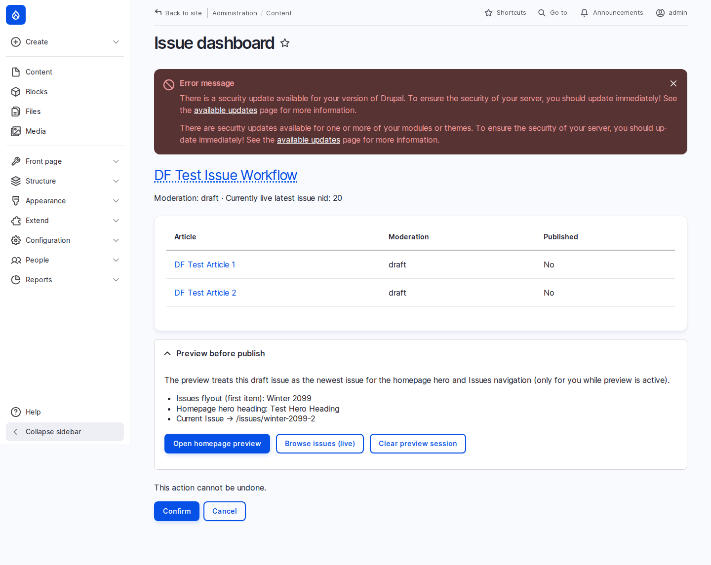

# Web editor guide — publishing a new issue

This walkthrough covers creating a magazine issue, adding articles, and publishing everything so the header **Issues** menu, homepage hero, and **Browse Issues** page update without manual menu or block edits.

## Before you start

- You need the **Web editor** role.
- You cannot open **Impact site settings**, **Site snippets**, block layout, user accounts, or module screens (you will get “access denied”).
- Homepage hero video, poster, and heading are edited by **site admins** only—you will not see those fields on the issue form.

## Issue dashboard (recommended)

**Content → Issue dashboard** (`/admin/content/issue-dashboard`)



The dashboard shows:

- The **next draft issue** (newest draft by year/season)
- **Attached articles** with moderation and published status
- **Preview before publish** — open the homepage with this issue treated as the current featured issue (Issues nav + hero preview for you only)
- **Publish issue and all attached articles** — one confirmation step

Use **Open homepage preview** to review the cover band and Issues flyout before going live. **Clear preview session** removes the preview cookie when you are done.

## Step 1 — Create the issue (draft)

1. **Content → Add content → Issue**
2. Fill in **Season**, **Year**, and title (for example “Fall 2026 Issue”).
3. Add **Cover** and **Banner** as needed.
4. Set **Moderation state** to **Draft**.
5. Save.

## Step 2 — Create articles as drafts

For each story in the issue:

1. **Content → Add content → Article**
2. Write the story in the **Content** tab using the **Full HTML** editor (same patterns as migrated WordPress stories):

   

   - **Pull quote:** Blockquote toolbar button, or Source view with `wp-block-pullquote` markup
   - **Image + caption:** Image button or `<figure class="wp-block-image">` with `<figcaption class="wp-element-caption">`
   - **Vimeo / YouTube:** Media embed or iframe in Source view (`wp-block-embed` wrapper)
   - **Button:** Source view — `wp-block-button` / `wp-block-button__link`
   - **Spacer:** Source view — `<div class="wp-block-spacer" style="height:…">`

3. In **Publication & placement**, set **Issue** to the issue you created.
4. Use **Show under Digital Exclusives** if the story should appear in that homepage row (independent of the issue).
5. Set **Moderation state** to **Draft**.
6. Save.

### Media library

When you upload or reuse **images**, **Alternative text is required** on every image (accessibility and WordPress parity).

### Schedule a go-live time (optional)

On the issue or article edit form, use **Publish on** (Scheduler) to pick a date and time. The content will flip to published automatically.

## Step 3 — Submit for review (optional)

If your team uses review before launch:

1. Edit the issue or an article.
2. Set **Moderation state** to **In review**.
3. Save.

A site admin or another editor with publish rights can set **Published** when ready.

## Step 4 — Publish the issue and all articles together

When content is ready to go live:

1. Open **Content → Issue dashboard**, or the **issue** edit form.
2. Click **Publish issue and all attached articles** (dashboard or issue form).

   **Or** set **Moderation state** to **Published** and save — attached articles in draft will also be published automatically.

3. Confirm success messages.

## What updates automatically

After the issue is published:

| Area | Behavior |
| --- | --- |
| **Issues** header dropdown | Newest published issue first |
| **Current Issue** (top nav) | Links to the newest published issue (no menu URL edit) |
| **Homepage hero** | Video, poster, and heading from the newest published issue |
| **Homepage “Explore” grid** | Articles from the newest issue |
| **Browse Issues** | Lists the new issue |

## Automated checks

From a bootstrapped VM:

```bash
cd drupal/web/modules/custom/df_editor && ../../../../vendor/bin/phpunit -c phpunit.xml.dist
../vendor/bin/drush df-editor:test-publish-workflow
../vendor/bin/drush df-editor:test-article-patterns
```
